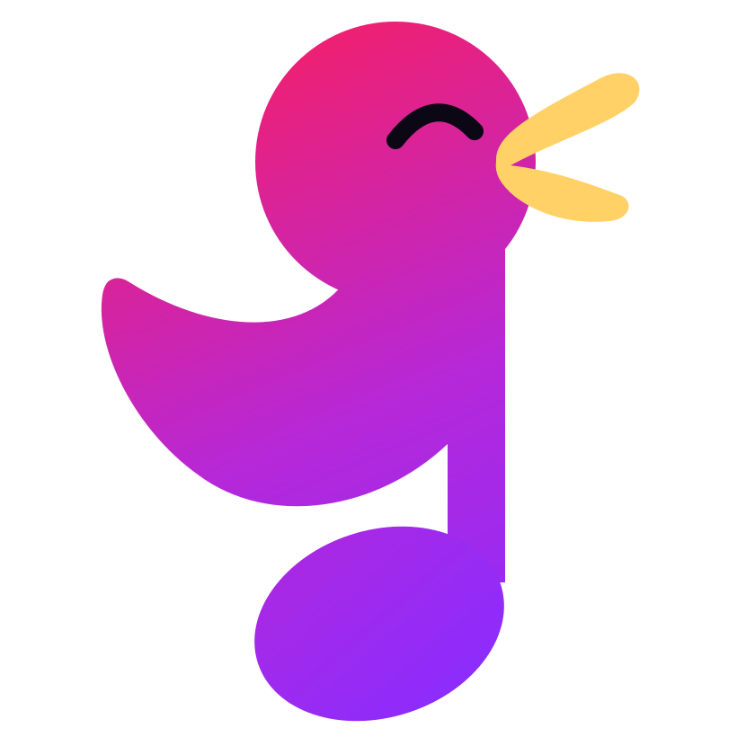

# KaraDuck — คาราโอเกะจาก YouTube



KaraDuck เป็นเว็บคาราโอเกะหลายห้อง จอหลักเล่นเพลงจาก YouTube และแขกสั่งเพลงจากมือถือได้
แต่ละห้องมีคิว ประวัติ และลิงก์แยกกัน ระบบออนไลน์ใช้ Vercel กับ Firebase Realtime Database
ไม่มี dependency จาก npm และไม่มีขั้น build ใช้ Node.js 22 ขึ้นไป

## ใช้งานบนเว็บ

เปิด [KaraDuck](https://karaduck.vercel.app) แล้วตั้งชื่อห้องเพื่อสร้างห้อง เครื่องที่สร้างเป็นจอหลัก
หากเบราว์เซอร์จำห้องเดิมไว้ จะกลับเข้าห้องเดิม เก็บลิงก์เจ้าของไว้เป็นส่วนตัว ผู้มีลิงก์ควบคุมห้องได้

แขกเข้าผ่าน QR บนจอหลัก ลิงก์แขก หรือเปิด `/remote` แล้วกรอก PIN ตัวเลข 6 หลัก
ค้นหาเพลงแล้วเพิ่มคิวได้ จอหลักต้องเปิดอยู่เพื่อเล่นเพลง บางเบราว์เซอร์ต้องกดเล่นครั้งแรกเอง
ในแท็บมือถือ เจ้าของคัดลอกลิงก์แขก เปลี่ยนรหัสแขก หรือกดปิดห้องและยืนยันได้ การเปลี่ยนรหัสทำให้ลิงก์แขกและ PIN เดิมใช้ไม่ได้

ผู้ดูแลเปิด `/admin` แล้วล็อกอินด้วย Google บัญชีต้องอยู่ในรายชื่อผู้ดูแล
หน้านี้ดูห้องทั้งหมด สร้างหรือปิดห้อง ออกลิงก์เจ้าของใหม่ และเปิด/ปิดการรับสร้างห้องได้
การปิดรับสร้างห้องไม่ปิดห้องที่มีอยู่

## รันบนเครื่องตัวเอง

```bash
node server.mjs
```

เปิดลิงก์เจ้าของที่พิมพ์ตอนเริ่มเซิร์ฟเวอร์ ไม่ใช้ IP เพื่อยืนยันสิทธิ์
ครั้งแรกสร้างห้องชื่อ “บ้าน” และเก็บกุญแจใน `data/secrets.json` ส่วนข้อมูลห้องอยู่ใน `data/rooms.json`
รีสตาร์ตแล้วใช้ข้อมูลเดิม เซิร์ฟเวอร์ไม่แตะ `data/state.json` ของเวอร์ชันเดิม
ลิงก์แขกใช้ที่อยู่เครือข่ายของเครื่อง แขกต้องเชื่อมต่อถึงเครื่องนี้ได้

| ตัวแปร | ความหมาย | ค่าเริ่มต้น |
|---|---|---|
| `PORT` | พอร์ต HTTP | 8791 |
| `HOST` | ที่อยู่ที่รับการเชื่อมต่อ | ทุกอินเทอร์เฟซ |
| `DATA_DIR` | โฟลเดอร์ข้อมูลและกุญแจ | `data` จากโฟลเดอร์ที่รัน |
| `CREATE_DISABLED` | ตั้งเป็น `1` เพื่อปิดรับสร้างห้อง | ไม่ปิด |

```bash
PORT=8792 HOST=127.0.0.1 DATA_DIR=./data-dev node server.mjs
```

ดูหน้าตาโดยไม่ใช้ห้องจริง: `http://localhost:8792/?demo=1&tab=queue`
ค่า `tab` ใช้ `results`, `queue`, `history`, `remote` และเพิ่ม `&idle=1` เพื่อดูจอว่าง
ควรใช้พอร์ตและโฟลเดอร์ข้อมูลแยกจากตัวที่กำลังใช้งาน

## นำขึ้น Vercel และ Firebase

1. สร้าง Realtime Database และบัญชีบริการที่มีสิทธิ์อ่านเขียนฐานข้อมูล เก็บกุญแจเฉพาะฝั่งเซิร์ฟเวอร์
2. เผยแพร่ `database.rules.json` ใน Firebase Console กฎปิดอ่าน/เขียนที่ราก แต่เปิดอ่านห้องรายตัวเมื่อรู้ id ห้ามเปิดเขียนสาธารณะ รายชื่อห้อง `/meta` และ `/usage` ไม่เปิดอ่าน
3. เปิด Google provider ใน Firebase Authentication และเพิ่มโดเมนเว็บใน Authorized domains สำหรับหน้าผู้ดูแล สร้าง Web app เพื่อรับ config และตั้งรายชื่อผู้ดูแลใน env
4. ตั้ง env ด้านล่างใน Vercel แล้ว deploy โครงการนี้ `vercel.json` ใช้ `public` เป็นไฟล์เว็บ ฟังก์ชันอยู่สิงคโปร์ (`sin1`) จำกัดเวลา 15 วินาที และแนบตรรกะคิวที่ใช้ร่วมกัน
5. ตรวจสร้างห้อง เข้า PIN เปลี่ยนรหัส ปิดห้อง และ Google login บนเว็บจริง ตั้ง Firewall และซ้อมสองห้องตาม [REVIEW](docs/REVIEW.md)

ตัวแปรทั้งหมดที่ `lib/vercel.mjs` อ่าน (ตารางนี้ระบุชื่อและความหมายเท่านั้น):

| ชื่อ | ความหมาย | บังคับหรือไม่ |
|---|---|---|
| `FIREBASE_DB_URL` | URL ของ Realtime Database | บังคับ |
| `FIREBASE_CLIENT_EMAIL` | ตัวระบุบัญชีบริการจากไฟล์กุญแจ | บังคับ |
| `FIREBASE_PRIVATE_KEY` | กุญแจส่วนตัวของบัญชีบริการ รองรับ newline และ `\n` | บังคับ |
| `ROOM_SECRET` | ความลับสำหรับเซ็นโทเคนห้อง | บังคับ |
| `ADMIN_KEY` | กุญแจผู้ดูแลสำหรับเครื่องมือ CLI | ไม่บังคับ ถ้าใช้ Google อย่างเดียว |
| `PUBLIC_ORIGIN` | ฐาน URL สำหรับลิงก์ หากไม่ตั้งใช้ HTTPS จาก Host ของคำขอ | ไม่บังคับ ควรตั้งบนเว็บจริง |
| `FIREBASE_WEB_CONFIG` | ข้อความ JSON มี `apiKey`, `authDomain`, `projectId`, `appId`; ค่าที่ถูกต้องถูกส่งให้หน้าเว็บ | จำเป็นสำหรับ Google login บนหน้าเว็บ |
| `ADMIN_EMAILS` | รายชื่อบัญชี Google ที่อนุญาต คั่นด้วยจุลภาค ตัดช่องว่างและเทียบตัวพิมพ์เล็ก | จำเป็นสำหรับสิทธิ์ผู้ดูแลผ่าน Google |
| `FIREBASE_PROJECT_ID` | project id สำหรับตรวจ ID token; ถ้าไม่ตั้งใช้ `projectId` จาก Web config หรืออนุมานจากบัญชีบริการ | ไม่บังคับถ้าอนุมานได้ |
| `SEARCH_DISABLED` | ตั้งเป็น `1` เพื่อปิดค้นหาและตรวจเพลงฉุกเฉิน | ไม่บังคับ |
| `CREATE_DISABLED` | ตั้งเป็น `1` เพื่อบังคับปิดสร้างห้องสาธารณะ แม้ผู้ดูแลเปิดสวิตช์ | ไม่บังคับ |

ขาดตัวบังคับใดตัวหนึ่ง ทุก API บน Vercel ตอบ `503 not_configured`
ถ้าไม่มีทั้งกุญแจและ Google ที่ตั้งค่าครบ API ผู้ดูแลตอบ `503 admin_disabled`

```bash
node tools/setup.mjs
```

สคริปต์นี้สุ่มกุญแจและพิมพ์คำแนะนำ ไม่บันทึกไฟล์หรือเรียกเครือข่าย ผลลัพธ์มีความลับ ห้ามนำไปเผยแพร่
สคริปต์ยังไม่แนะนำ env สำหรับ Google และการสร้างห้องสาธารณะครบ ต้องตั้งตามตารางด้วยตนเอง

ตั้ง `KARAOKE_ADMIN_KEY` ในเทอร์มินัลให้ตรงกับกุญแจผู้ดูแล แล้วใช้คำสั่งต่อไปนี้ โดยแทน `<roomId>` ด้วยห้องที่ต้องการ:

```bash
node tools/room.mjs create "ห้องทดสอบ" --url https://karaduck.vercel.app
node tools/room.mjs list --url https://karaduck.vercel.app
node tools/room.mjs rotate-owner '<roomId>' --url https://karaduck.vercel.app
node tools/room.mjs delete '<roomId>' --url https://karaduck.vercel.app
node tools/room.mjs list --local
```

ไม่ระบุ `--url` ใช้ `KARAOKE_URL` หรือ `PUBLIC_ORIGIN` แทนได้
`--local` ใช้พอร์ตจาก `PORT` หรือ 8791 และอ่านกุญแจจาก `data/secrets.json` เสมอ ไม่อ่าน `DATA_DIR`
ถ้าใช้โฟลเดอร์ข้อมูลอื่น ต้องจัดกุญแจให้ CLI ผ่าน env แล้วระบุ `--url` เอง ผลลัพธ์การสร้างและออกลิงก์ใหม่มีลิงก์เจ้าของ ให้ส่งทางช่องทางส่วนตัว

## เพดาน

ค่าจาก `lib/limits.mjs`:

| ค่าคงที่ | เพดาน | ผล |
|---|---|---|
| `MAX_ROOMS` | 30 ห้อง | สร้างสาธารณะเกินแล้ว `503 rooms_full` |
| `CREATES_PER_HOUR` | 20 ห้องต่อชั่วโมงนาฬิกา รวมเว็บ | `429 too_many_rooms` |
| `IDLE_MS` | 24 ชั่วโมงนับจากการเขียนคิวล่าสุด | ลบตอนสร้างสาธารณะหรือผู้ดูแลดูรายการ ไม่ใช่งานตามเวลา |
| `SEARCHES_PER_HOUR` | 120 คำขอต่อห้องต่อชั่วโมงนาฬิกา | `429 search_budget` |
| `JOIN_FAILS_PER_MINUTE` | ใส่ PIN ผิด 30 ครั้งต่อนาทีนาฬิกา รวมเว็บ | หลังถึงเพดาน join ทั้งหมดได้ `429 too_many_attempts` จนเปลี่ยนนาที |

ผู้ดูแลสร้างห้องได้โดยข้ามเพดานจำนวนและความถี่ คิวรอสูงสุด 200 เพลง ประวัติ 30 เพลง (`public/js/store.js`)
การค้นหาและรายงานสถานะเล่นไม่ต่ออายุห้อง มีเพียงคำสั่งที่เขียน `q` เท่านั้น ห้องเก่าที่ `updatedAt` เป็น 0 ยังไม่ถูกลบอัตโนมัติ

## ข้อจำกัดที่ควรรู้

- การค้นหาใช้ InnerTube และตรวจเพลงจากหน้า embed เป็นช่องทาง YouTube ที่ไม่เป็นทางการ อาจเปลี่ยนหรือถูกจำกัด IP ได้
- เล่นผ่าน YouTube IFrame Player API อาจมีโฆษณา และบางเพลงไม่อนุญาตให้ฝัง ผลตรวจล่วงหน้าไม่รับประกันว่าจะเล่นได้ทุกเครื่อง ปรับคีย์ ตัดเสียงร้อง และให้คะแนนไม่ได้
- แผนฟรีของ Vercel และ Firebase มีเพดานการใช้ทรัพยากร ต้องดูการใช้งานจริงและโควตาในบัญชี เพดานในแอปไม่ได้แทนเพดานแพลตฟอร์ม
- ใช้ส่วนตัว การเปิดในที่สาธารณะหรือเชิงพาณิชย์ต้องตรวจข้อตกลงแพลตฟอร์มและลิขสิทธิ์เพลง
- ผู้รู้ id ห้องอ่านข้อมูลเพลงและชื่อคนขอผ่าน Firebase ได้ แม้โทเคนแขกเก่าถูกยกเลิกแล้ว ไม่ใส่ข้อมูลส่วนตัวในชื่อห้องหรือชื่อคนขอ

## โครงสร้างและการทดสอบ

```text
server.mjs             HTTP และช่องฟังบนเครื่อง
api/                   จุดเข้า Vercel ทั้ง 8 เส้นทาง
lib/                   สิทธิ์ ห้อง ฐานข้อมูล YouTube QR และ security headers
public/                HTML CSS โลโก้ และ JavaScript ไม่มี build
  js/store.js          ตรรกะคิวที่ใช้ร่วมกับเซิร์ฟเวอร์
  js/commands.js       ตรวจและใช้คำสั่งคิว
  js/session.js        เก็บโทเคนห้อง
  js/sync.js           เชื่อมช่องฟังและส่งคำสั่ง
  js/room-merge.js     รวมข้อมูล Firebase
  js/admin.js          หน้าผู้ดูแล
  js/admin-view.js     ตรรกะแสดงรายการผู้ดูแล
tools/                 setup.mjs และ room.mjs
test/                  Node test runner และ fixtures
docs/                  สัญญา รีวิว แบบระบบ และคู่มือ
design/                ไฟล์งานออกแบบโลโก้
database.rules.json    กฎ Realtime Database
vercel.json            การตั้งค่า deploy และ headers
```

```bash
npm test
```

สัญญาระบบอยู่ใน [DESIGN](docs/DESIGN.md) และสถานะข้อรีวิวอยู่ใน [REVIEW](docs/REVIEW.md)
