# คู่มือการใช้งาน KaraDuck

## 1. KaraDuck คืออะไร

KaraDuck เป็นเว็บร้องคาราโอเกะจาก YouTube เปิดได้ที่ `https://<เว็บของคุณ>`
จอหลักเล่นเพลงและแสดงเนื้อร้อง ส่วนคุณใช้มือถือค้นหาและสั่งเพลงได้  
แต่ละห้องมีคิวเพลงของตัวเอง ให้คนในบ้านช่วยกันเลือกเพลงได้

ในคู่มือนี้ `https://<เว็บของคุณ>` หมายถึงที่อยู่ KaraDuck ที่คุณหรือผู้ดูแลของคุณติดตั้งไว้ หน้าเข้าห้องคือ `https://<เว็บของคุณ>/remote` และหน้าผู้ดูแลคือ `https://<เว็บของคุณ>/admin`

คู่มือฉบับย่อสำหรับผู้ใช้เปิดดูในแอปได้ที่ `/help`

ยังไม่มีเว็บ KaraDuck ของตัวเอง → ดู [คู่มือติดตั้งเอง](INSTALL.md)

สิ่งที่ต้องมี:

- จอคอมหรือทีวีที่เปิดเว็บได้ ต่ออินเทอร์เน็ต และมีลำโพง หรือใช้คอมต่อภาพและเสียงเข้าทีวี
- มือถือของแต่ละคนที่ต่ออินเทอร์เน็ตและเปิดเว็บได้
- ให้จอหลักเปิดอยู่ตลอดเวลาที่ร้องเพลง เสียงออกจากจอหลัก ไม่ใช่มือถือ

ภาพในคู่มือใช้สาธิตเท่านั้น รหัส `123 456` และรหัส `644 875` ในภาพไม่ใช่รหัสสำหรับเข้าห้องของคุณ คุณต้องใช้รหัสที่จอหลักของคุณแสดง

## 2. เริ่มใน 3 ขั้น

1. **สร้างห้อง:** เปิด `https://<เว็บของคุณ>` บนจอหลัก ใส่ชื่อห้อง แล้วกด `สร้างห้อง`
2. **ชวนแขก:** ให้คุณและแขกสแกน QR จากจอหลัก หรือเปิด `https://<เว็บของคุณ>/remote` แล้วใส่รหัส 6 หลัก
3. **สั่งเพลง:** พิมพ์ชื่อเพลง กด `ค้นหา` แล้วกด `เข้าคิว` ใต้เพลงที่ต้องการ ถ้าเพลงยังไม่เริ่ม ให้เจ้าของกด `เล่น` ที่จอหลักหนึ่งครั้ง

## 3. สำหรับเจ้าของห้อง (จอหลัก)

### สร้างห้อง

1. เปิด `https://<เว็บของคุณ>` บนคอมที่ต่อทีวี หรือเบราว์เซอร์ของจอหลัก
2. ที่การ์ด `สร้างห้องคาราโอเกะ` ใส่ `ชื่อห้อง` ยาวไม่เกิน 40 ตัวอักษร เช่น บ้านคุณยาย
3. กด `สร้างห้อง` แล้วรอจอหลักเปิด คุณเป็นเจ้าของห้องบนเบราว์เซอร์นี้ทันที

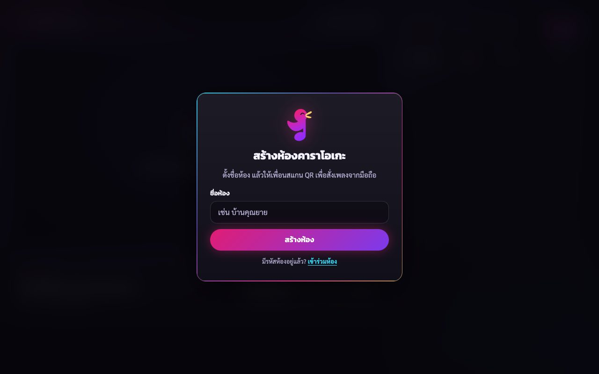

หากคุณมี YouTube Premium ให้ลองเปิดจอหลักด้วยเบราว์เซอร์ที่เข้าสู่ระบบบัญชีนั้นไว้ เพื่อใช้สิทธิ์ดูแบบไม่มีโฆษณา การเล่นผ่านเว็บนี้ยังอาจมีโฆษณาได้ จึงไม่รับประกันว่าจะไม่มีโฆษณาทุกครั้ง

### ทำความรู้จักจอหลัก

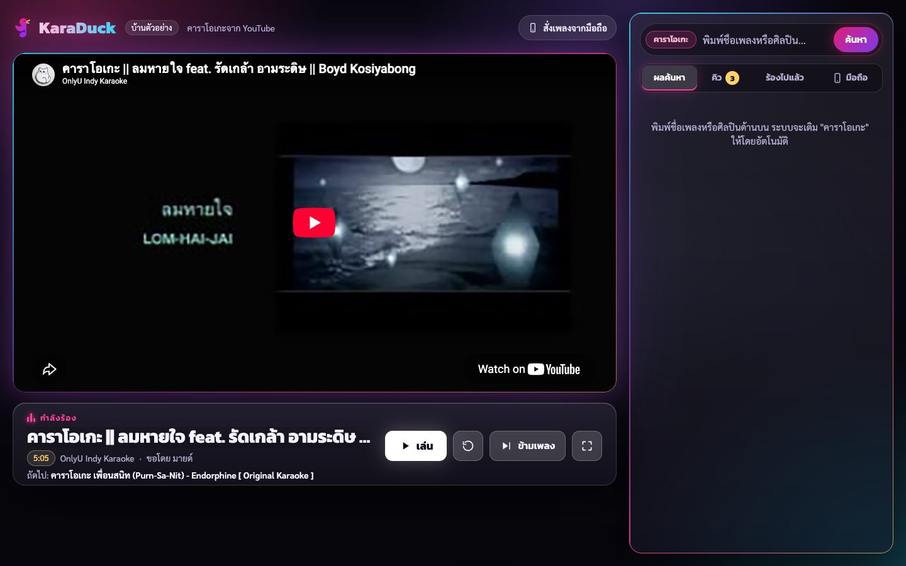

- **วิดีโอ:** อยู่ด้านซ้าย ใช้ดูภาพและเนื้อร้อง ภาพตัวอย่างยังรอกดเล่น
- **แถบ `กำลังร้อง`:** อยู่ใต้วิดีโอ แสดงชื่อเพลง ความยาว ช่องของเพลง ชื่อคนขอถ้ามี และเพลงถัดไป
- **ปุ่ม `เล่น` / `หยุด`:** เริ่มเล่นหรือหยุดเพลงชั่วคราว ปุ่มหยุดมีชื่อสำหรับการอ่านหน้าจอว่า `หยุดชั่วคราว`
- **ปุ่ม `เริ่มใหม่`:** รูปลูกศรวน เริ่มเพลงปัจจุบันจากต้น
- **ปุ่ม `ข้ามเพลง`:** จบเพลงปัจจุบันแล้วเล่นเพลงถัดไป ถ้าไม่มีคิวจะกลับเป็นจอว่าง
- **ปุ่ม `โหมดเวที`:** รูปมุมสี่ด้าน ขยายส่วนจอเพลงเป็นเต็มจอ กด `ออกจากโหมดเวที` หรือกด Esc เพื่อกลับ บางเบราว์เซอร์ไม่มีปุ่มนี้

แผงด้านขวามี 4 แท็บ:

| แท็บ | ใช้ทำอะไร |
|---|---|
| `ผลค้นหา` | เลือกเพลงจากคำที่คุณค้น |
| `คิว` | ดูเพลงที่รอและจัดลำดับ |
| `ร้องไปแล้ว` | ดูประวัติ แล้วกด `เข้าคิว` เพื่อร้องซ้ำได้ หรือกด `ล้างประวัติ` แล้วยืนยัน `แน่ใจ?` |
| `มือถือ` | ดู QR รหัสห้อง และจัดการการเข้าห้อง |

### ค้นหาและเพิ่มเพลง

1. พิมพ์ชื่อเพลงหรือศิลปินในช่องด้านขวาบน แล้วกด `ค้นหา`
2. ระบบเติมคำว่า “คาราโอเกะ” ให้ คุณไม่ต้องพิมพ์ซ้ำ
3. เลือกวิธีสั่งเพลงใต้ผลค้นหา ปุ่มบางปุ่มเป็นรูปภาพ ให้ชี้เมาส์เพื่อดูชื่อ

| ปุ่ม | ผลที่เกิดขึ้น |
|---|---|
| `เข้าคิว` | เพิ่มท้ายคิว ถ้ายังไม่มีเพลงกำลังเล่น จะเริ่มเพลงนี้ทันที |
| `เล่นถัดไป` | เพิ่มเป็นเพลงแรกที่รอ ถ้ายังไม่มีเพลงกำลังเล่น จะเริ่มทันที |
| `เล่นเลย` | เปลี่ยนมาเล่นเพลงนี้ทันที เพลงที่กำลังเล่นย้ายไปประวัติ |

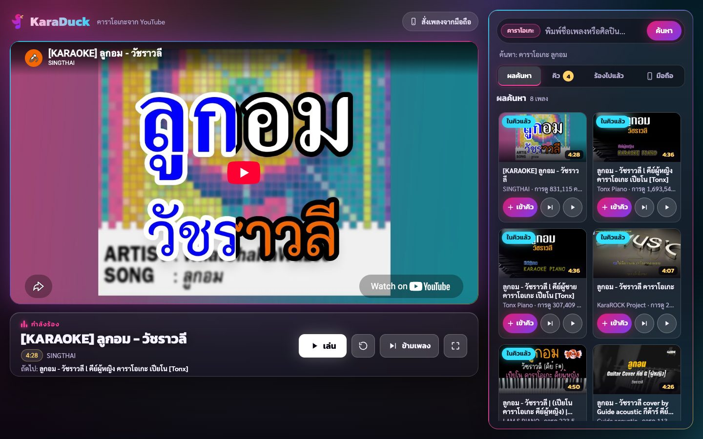

ป้าย `ในคิวแล้ว` บอกว่าเพลงนั้นกำลังเล่นหรืออยู่ในคิว คุณยังสั่งซ้ำได้ ส่วนป้าย `เล่นที่นี่ไม่ได้` หมายถึงผลตรวจพบว่าเพลงนั้นเล่นผ่านหน้านี้ไม่ได้ ปุ่มสั่งเพลงจะใช้ไม่ได้ ให้เลือกคลิปอื่น แม้ไม่มีป้ายก็ยังอาจเล่นไม่สำเร็จได้

### จัดคิว

เปิดแท็บ `คิว` ด้านบนเป็นเพลงที่กำลังร้อง ด้านล่างเป็น `คิวถัดไป`

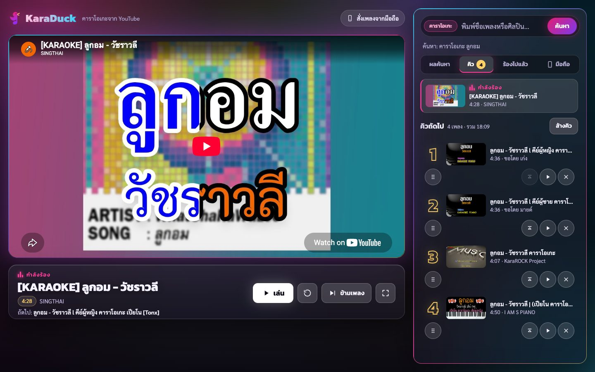

- **ลากสลับลำดับ:** จับปุ่มจุดที่แถวเพลงค้างไว้ แล้วลากขึ้นหรือลง คุณใช้ปุ่มลูกศรขึ้น–ลงบนแป้นพิมพ์เมื่อเลือกปุ่มลากได้ด้วย
- **`ขึ้นบนสุด`:** ย้ายเพลงนั้นเป็นเพลงถัดไป ไม่ขัดเพลงที่กำลังร้อง
- **`เล่นเลย`:** เลือกเพลงในคิวให้เล่นทันที เพลงเดิมไปประวัติ
- **`ลบ`:** เอาเพลงนั้นออกจากคิว
- **`ล้างคิว`:** กดแล้วกด `แน่ใจ?` อีกครั้ง ลบเพลงที่รอทั้งหมด เพลงที่กำลังเล่นยังเล่นต่อ

### ชวนแขกเข้าห้อง

กดแท็บ `มือถือ` หรือปุ่ม `สั่งเพลงจากมือถือ` ด้านบนจอหลัก แล้วเลือกวิธีที่สะดวก:

1. ให้แขกเปิดกล้องมือถือ ส่อง QR และแตะลิงก์ที่กล้องแสดง
2. ให้แขกเปิด `https://<เว็บของคุณ>/remote` แล้วใส่รหัสห้อง 6 หลักจากจอ เช่น `123 456` เป็นเพียงตัวอย่าง
3. กด `คัดลอกลิงก์แขก` แล้วส่งให้คนที่คุณต้องการชวน

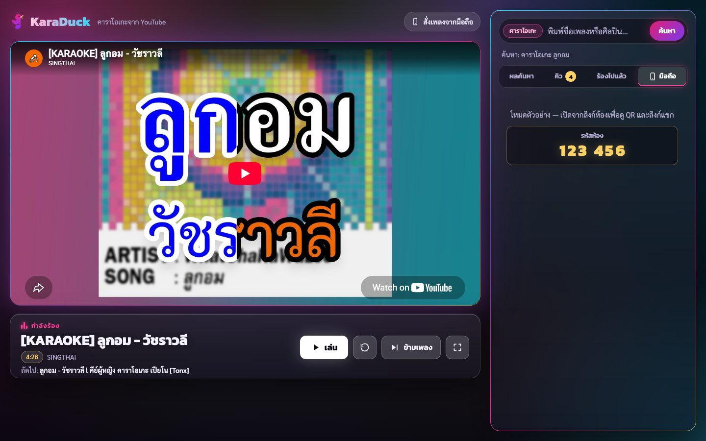

ภาพนี้แสดง QR ลิงก์เข้าห้อง รหัส 6 หลัก พร้อมปุ่ม `คัดลอกลิงก์แขก` `เปลี่ยนรหัสแขก` และ `ปิดห้อง` ที่อยู่ `localhost:8793` เป็นเครื่องทดลอง ของจริงจะเป็นที่อยู่เว็บของคุณ หากสร้างภาพ QR ไม่ได้ ให้ใช้ลิงก์แขกแทน

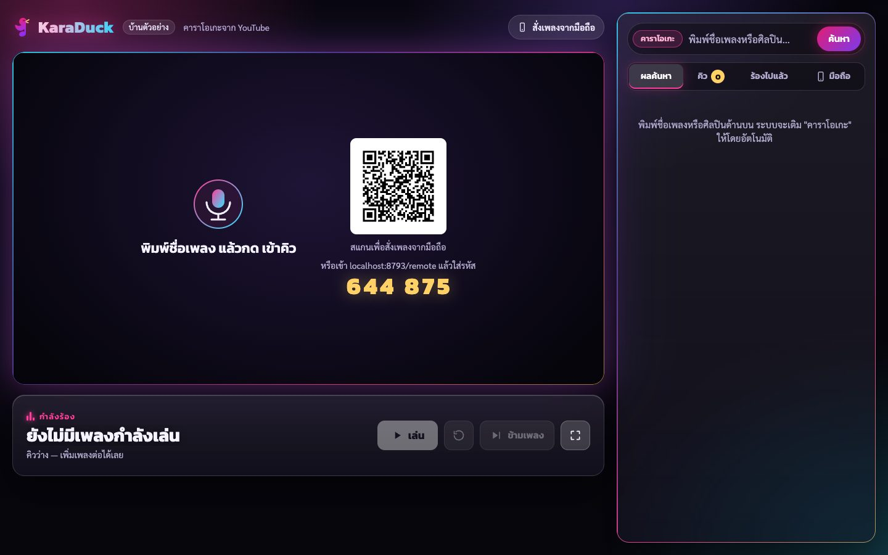

ตอนยังไม่มีเพลง จอหลักแสดง QR และรหัสกลางจอเมื่อข้อมูลพร้อม ตามภาพนี้ ที่อยู่ `localhost:8793` เป็นเครื่องทดลอง ของจริงจะเป็นที่อยู่เว็บของคุณ ให้แขกสแกน QR หรือเปิดหน้าเข้าห้องของเว็บคุณแล้วใส่รหัสตามจอ

### เปลี่ยนรหัสแขก

ใช้เมื่อคุณต้องการให้คนที่มีลิงก์หรือรหัสเดิมสั่งเพลงต่อไม่ได้

1. เปิดแท็บ `มือถือ` กด `เปลี่ยนรหัสแขก`
2. กด `แน่ใจ?` อีกครั้งเพื่อยืนยัน
3. รอ QR ลิงก์แขก และรหัส 6 หลักชุดใหม่ แล้วชวนคนที่ต้องการเข้าห้องอีกครั้ง

มือถือที่เข้าอยู่ทุกเครื่องจะใช้สิทธิ์เดิมต่อไม่ได้ ต้องสแกน QR ใหม่ เปิดลิงก์ใหม่ หรือใส่รหัสใหม่ คิวและประวัติยังอยู่ จอหลักยังใช้ต่อได้ การเปลี่ยนรหัสไม่ได้ลบข้อมูลเพลงที่แขกเคยเห็น จึงควรใช้ชื่อเล่นและไม่ใส่ข้อมูลส่วนตัว

### ปิดห้อง

เปิดแท็บ `มือถือ` กด `ปิดห้อง` แล้วกด `กดอีกครั้งเพื่อปิดห้อง` เพื่อยืนยัน
ห้อง คิว และประวัติจะถูกลบ กู้คืนไม่ได้ มือถือที่เข้าอยู่จะเห็น `ห้องนี้ถูกปิดแล้ว` รหัสและลิงก์เดิมใช้ไม่ได้
หากคุณจะร้องต่อ ให้กด `สร้างห้องใหม่` และชวนแขกเข้าห้องใหม่

### กลับเข้าห้องเดิม หรือเปิดจอหลักบนเครื่องอื่น

- **เครื่องเดิม:** เปิดหน้าแรกด้วยเบราว์เซอร์และผู้ใช้เบราว์เซอร์เดิม เครื่องจะจำห้องและกลับเข้าเอง ตราบใดที่ห้องยังอยู่และสิทธิ์เจ้าของยังใช้ได้
- **เครื่องอื่น:** ขอให้ผู้ดูแลออกลิงก์เจ้าของใหม่ แล้วส่งให้คุณเป็นการส่วนตัว เปิดลิงก์นั้นบนเครื่องที่จะเป็นจอหลัก ลิงก์เจ้าของเดิมจะใช้ไม่ได้ ควรเปิดเล่นเพียงจอเดียวเพื่อไม่ให้เสียงซ้อน
- **อย่าคัดลอกที่อยู่หน้าเว็บหลังเข้าห้องเพื่อย้ายเครื่อง:** ส่วนที่ใช้เข้าห้องถูกนำออกจากแถบที่อยู่หลังเปิดสำเร็จ ที่อยู่ที่เหลือจึงไม่ใช่ลิงก์เจ้าของ
- **ล้างข้อมูลเบราว์เซอร์ เปลี่ยนเบราว์เซอร์ หรือใช้หน้าต่างส่วนตัว:** อาจทำให้เครื่องจำห้องไม่ได้ การล้างข้อมูลไม่ได้ปิดห้อง แต่คุณจะกลับไปเป็นเจ้าของจากหน้าแรกเองไม่ได้ ให้ขอลิงก์เจ้าของใหม่จากผู้ดูแล
- ถ้าเบราว์เซอร์ไม่ยอมเก็บข้อมูล ความจำห้องอาจอยู่แค่หน้าที่เปิดอยู่ เมื่อโหลดใหม่อาจต้องเข้าจากลิงก์อีกครั้ง
- QR รหัส 6 หลัก และลิงก์แขกใช้เข้าหน้ามือถือ ไม่ได้ให้สิทธิ์เป็นเจ้าของห้อง

## 4. สำหรับแขก (มือถือ)

### เข้าห้องได้ 3 วิธี

เลือกเพียงวิธีเดียว คุณไม่ต้องสร้างห้องใหม่:

1. **สแกน QR:** เปิดกล้องมือถือ ส่อง QR บนจอหลัก แล้วแตะลิงก์ที่กล้องแสดง
2. **ใส่รหัส:** เปิด `https://<เว็บของคุณ>/remote` ใส่ `รหัสห้อง 6 หลัก` ตามจอหลัก ระบบลองเข้าให้เมื่อครบ 6 หลัก หรือคุณกด `เข้าร่วม` ได้
3. **เปิดลิงก์:** แตะลิงก์แขกที่เจ้าของส่งมา แล้วเปิดในเบราว์เซอร์บนมือถือ

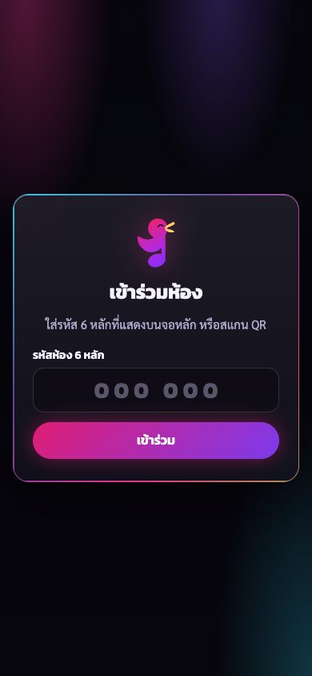

หากมือถือจำห้องเดิมไว้ อาจเข้าห้องเดิมทันที ถ้าจะเปลี่ยนห้อง ให้สแกน QR หรือเปิดลิงก์แขกของห้องที่ต้องการ

### ใส่ชื่อคนสั่งเพลง

ตรวจชื่อห้องด้านบนก่อน พิมพ์ชื่อเล่นในช่อง `ชื่อคนสั่งเพลง (ไม่ใส่ก็ได้)` ยาวไม่เกิน 20 ตัวอักษร
ชื่อจะติดกับเพลงที่คุณสั่งหลังจากนั้น และมือถือจำชื่อไว้ให้ คุณเว้นว่างได้ ไม่ต้องใส่ชื่อจริงหรือข้อมูลส่วนตัว

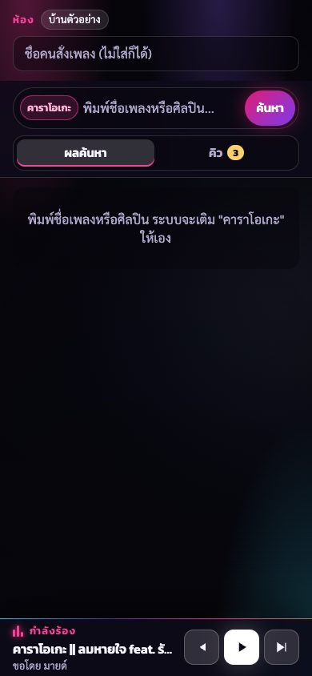

### ค้นหาและสั่งเพลง

1. พิมพ์ชื่อเพลงหรือศิลปิน แล้วกด `ค้นหา` ระบบเติมคำว่า “คาราโอเกะ” ให้เอง
2. กด `เข้าคิว` ใต้เพลงที่คุณต้องการ เพื่อเพิ่มท้ายคิว
3. ถ้าต้องการให้เป็นเพลงถัดไป กดปุ่มรูปเส้นกับลูกศรข้างปุ่มเข้าคิว ปุ่มนี้มีชื่อว่า `เล่นถัดไป`
4. ถ้ายังไม่มีเพลงกำลังเล่น ทั้งสองปุ่มจะเริ่มเพลงที่คุณเลือกทันที หากไม่มีเสียง ให้เจ้าของกดเล่นครั้งแรกที่จอหลัก

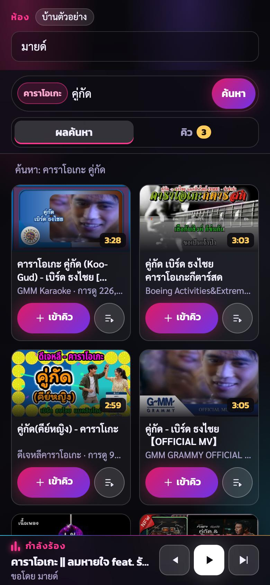

ป้าย `เล่นที่นี่ไม่ได้` หมายถึงคุณต้องเลือกคลิปอื่น ป้าย `ในคิวแล้ว` บอกว่าเพลงกำลังเล่นหรือรออยู่แล้ว ตรวจคิวก่อนกดซ้ำ

### ดูและจัดคิว

แตะแท็บ `คิว` คุณจะเห็นเพลงที่กำลังร้องและเพลงที่รอเรียงตามลำดับ คุณจัดเพลงของคนอื่นในห้องได้ด้วย จึงควรตกลงกันก่อน

- จับปุ่มจุดค้างไว้แล้วลากเพื่อย้ายลำดับ
- กด `ขึ้นบนสุด` ให้เพลงนั้นเป็นเพลงถัดไป
- กด `ลบ` เพื่อเอาเพลงออกจากคิว

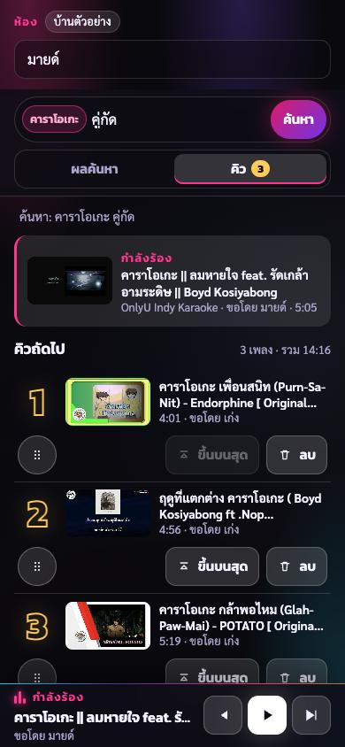

ปุ่มที่แถบล่างควบคุมเพลงบนจอหลัก:

| ปุ่ม | วิธีใช้ |
|---|---|
| `เริ่มใหม่` | ปุ่มซ้ายรูปย้อนกลับ เริ่มเพลงปัจจุบันจากต้น |
| `เล่น` / `หยุดชั่วคราว` | ปุ่มกลางรูปสามเหลี่ยมหรือขีดคู่ ใช้เล่นหรือหยุดชั่วคราว |
| `ข้ามเพลง` | ปุ่มขวา กดครั้งแรกจะขึ้น `แน่ใจ?` ให้กดซ้ำภายใน 3 วินาทีเพื่อยืนยันข้าม |

### สิ่งที่แขกทำไม่ได้

คุณล้างคิวทั้งหมด ล้างประวัติ เปลี่ยนรหัสแขก หรือปิดห้องไม่ได้ ให้เจ้าของทำจากจอหลัก
หน้ามือถือไม่มีปุ่ม `เล่นเลย` และไม่มีแท็บประวัติ คุณใช้ `เล่นถัดไป` หรือจัดลำดับในแท็บ `คิว` ได้

## 5. สำหรับผู้ดูแลระบบ

### เข้าสู่ระบบ

1. เปิด `https://<เว็บของคุณ>/admin`
2. กด `เข้าสู่ระบบด้วย Google` และเลือกบัญชีที่ได้รับสิทธิ์ผู้ดูแล
3. เมื่อผ่านการตรวจสิทธิ์ จะเห็นรายการห้องและส่วนจัดการ หากเลือกผิด ให้กด `เปลี่ยนบัญชี`

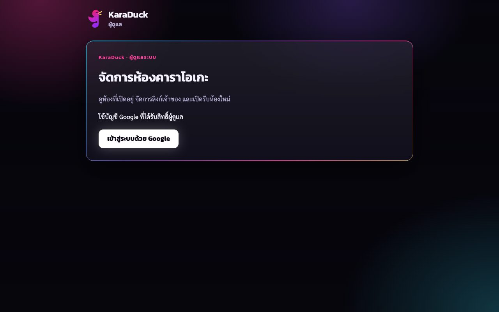

### ดูและจัดการห้อง

- **`ห้องทั้งหมด`:** แสดงชื่อห้อง จำนวนเพลงรอ เพลงที่กำลังเล่น เวลาสร้าง และเวลาใช้ล่าสุด อัปเดตทุก 15 วินาทีขณะเปิดหน้านี้ หรือกด `รีเฟรช` ห้องที่ใกล้ครบเวลาอาจมีป้าย `ใกล้หมดอายุ`
- **`ปิดห้อง`:** กดในแถวห้อง แล้วกด `ยืนยันปิดห้อง · ลบห้องและคิว` ซ้ำภายใน 4 วินาที ห้องและข้อมูลจะถูกลบ กู้คืนไม่ได้
- **`ออกลิงก์เจ้าของใหม่`:** ใช้เมื่อเจ้าของย้ายเครื่องหรือจำห้องไม่ได้ กดแล้วกด `ยืนยันออกลิงก์ใหม่ · ลิงก์เดิมจะใช้ไม่ได้` ภายใน 4 วินาที จะเห็นช่อง `ลิงก์เจ้าของใหม่` กด `คัดลอก` แล้วส่งให้เจ้าของเป็นการส่วนตัว ลิงก์เจ้าของเดิมใช้ไม่ได้ แต่แขกยังใช้ห้องต่อได้
- **`สร้างห้อง (ไม่ติดเพดาน)`:** ใส่ `ชื่อห้อง` แล้วกด `สร้างห้อง` จะได้ `ลิงก์เจ้าของห้อง` ส่งให้ผู้เปิดจอหลัก ห้องที่สร้างวิธีนี้ข้ามสวิตช์รับห้องใหม่และเพดานจำนวน/ความถี่สร้างห้อง แต่ยังติดเพดานค้นหาและคิว
- เมื่อเสร็จแล้ว กด `ออกจากระบบ` โดยเฉพาะเมื่อใช้เครื่องร่วมกับคนอื่น

### เปิดหรือปิดรับห้องใหม่

สวิตช์ `เปิดรับการสร้างห้อง` แสดง `เปิดอยู่` หรือ `ปิดอยู่` คุณปิดได้เมื่อมีคนสร้างห้องมาก หรือระบบค้นหาเริ่มมีปัญหา
ห้องที่เปิดอยู่ยังใช้งานต่อได้ สวิตช์นี้ไม่ปิดห้องและไม่หยุดค้นหาในห้องเดิม หน้าแรกที่เปิดค้างไว้อาจต้องรีเฟรช และบางครั้งรอได้ถึง 30 วินาทีจึงเห็นสถานะใหม่
ถ้าตั้ง `CREATE_DISABLED=1` ไว้ การเปิดสวิตช์ไม่สามารถยกเลิกการปิดแบบบังคับนั้นได้

### เพดานของระบบ

ห้ารายการแรกมาจาก `lib/limits.mjs` สองรายการท้ายเป็นข้อจำกัดคิวจาก `public/js/store.js`

| สิ่งที่จำกัด | จำนวนและผล |
|---|---|
| ห้องที่สร้างจากหน้าแรก | เปิดพร้อมกันได้ไม่เกิน 30 ห้อง ผู้ดูแลสร้างเพิ่มเกินจำนวนนี้ได้ |
| ความถี่สร้างห้องจากหน้าแรก | รวมทั้งเว็บไม่เกิน 20 ห้องต่อชั่วโมงนาฬิกา เริ่มนับรอบใหม่เมื่อขึ้นชั่วโมง |
| อายุห้องที่ไม่ได้เปลี่ยนข้อมูล | เกิน 24 ชั่วโมงจากการบันทึกข้อมูลคิวหรือสิทธิ์ห้องล่าสุด จะถูกลบเมื่อตรวจตอนสร้างห้องสาธารณะหรือผู้ดูแลดูรายการ |
| การค้นหา | รวมทุกคนในห้อง 120 คำขอต่อชั่วโมงนาฬิกา ขึ้นชั่วโมงแล้วเริ่มรอบใหม่ การค้นหาที่ส่งไปแต่ไม่สำเร็จก็นับได้ |
| การลองรหัสห้องผิด | รวมทั้งเว็บ 30 ครั้งต่อนาทีนาฬิกา เมื่อถึงจำนวนนี้ ทุกคนต้องรอเปลี่ยนนาทีจึงใส่รหัสได้อีก แม้ใส่ถูก ส่วน QR และลิงก์แขกยังใช้ได้ |
| เพลงที่รอในคิว | 200 เพลง ไม่รวมเพลงที่กำลังเล่น |
| ประวัติเพลง | เก็บล่าสุดไม่เกิน 30 เพลง ไม่เก็บเพลงเดิมซ้ำหลายรายการ |

การค้นหา การเปิดหน้าทิ้งไว้ และการกดเล่น/หยุดหรือเริ่มใหม่ ไม่ต่ออายุห้อง การเพิ่ม ลบ ย้าย หรือข้ามเพลงที่ทำให้บันทึกคิวเปลี่ยน รวมถึงเปลี่ยนสิทธิ์ จะต่ออายุห้อง
ห้องเก่าที่ยังไม่มีเวลาใช้ล่าสุดจะยังไม่ถูกลบอัตโนมัติ จนกว่าจะมีการบันทึกข้อมูลห้องครั้งแรก

การตั้งค่า การนำขึ้นเว็บ และวิธีรันบนเครื่อง ดู [README](../README.md) โดยเฉพาะส่วน “นำขึ้น Vercel และ Firebase” และ “รันบนเครื่องตัวเอง”

## 6. ข้อความที่อาจเจอและวิธีแก้

ข้อความในคอลัมน์ซ้ายคัดจากหน้าเว็บ บางปุ่มเป็นชื่อที่แสดงเมื่อชี้เมาส์หรือใช้ตัวอ่านหน้าจอ
ข้อความบัญชีผู้ดูแลจะแทรกชื่อบัญชีจริงระหว่างคำว่า “บัญชี” และ “ไม่มีสิทธิ์ผู้ดูแล” คู่มือนี้แสดงเป็น … เพื่อไม่เปิดเผยข้อมูลส่วนตัว

| ถ้าเห็น… | ให้ทำ… |
|---|---|
| `รหัสไม่ถูกต้อง ดูรหัสบนจอหลักอีกครั้ง` | ตรวจตัวเลขบนจอหลักอีกครั้ง อย่าใช้รหัสตัวอย่างในคู่มือ |
| `ใส่รหัสให้ครบ 6 หลัก` | ใส่ตัวเลขให้ครบ 6 หลัก แล้วกดเข้าร่วม |
| `มีการลองรหัสผิดบ่อยเกินไป รอสักครู่แล้วลองใหม่ หรือสแกน QR แทน` | รอจนเปลี่ยนนาที หรือใช้ QR หรือลิงก์แขกแทน |
| `เข้าร่วมไม่สำเร็จ ลองอีกครั้ง` | ตรวจอินเทอร์เน็ต แล้วลองอีกครั้ง หรือขอลิงก์แขกจากเจ้าของ |
| `รหัสห้องเปลี่ยนแล้ว สแกน QR จากจอหลักอีกครั้ง` | สแกน QR ใหม่ เปิดลิงก์ใหม่ หรือใส่รหัสใหม่จากจอหลัก |
| `ห้องนี้ถูกปิดแล้ว` | ห้องเดิมเข้าไม่ได้ ให้เจ้าของสร้างห้องใหม่และส่งคำเชิญใหม่ |
| `ลิงก์ห้องนี้ใช้ไม่ได้แล้ว` | ขอให้ผู้ดูแลออกลิงก์เจ้าของใหม่ หากห้องถูกลบต้องสร้างใหม่ |
| `ลิงก์ห้องหมดอายุหรือไม่ถูกต้อง กรุณาขอลิงก์ห้องใหม่จากผู้ดูแล` | ใช้ลิงก์เจ้าของที่ผู้ดูแลออกให้ล่าสุด |
| `ผู้ดูแลได้ปิดห้องนี้แล้ว หากต้องการใช้งานต่อ กรุณาขอลิงก์ห้องใหม่จากผู้ดูแล` | ติดต่อผู้ดูแล ข้อความนี้อาจปรากฏเมื่อห้องถูกลบเพราะหมดอายุด้วย |
| `คิวเต็มแล้ว (200 เพลง)` | รอเพลงในคิวเล่นจบ หรือลบเพลงที่ไม่ต้องการก่อนเพิ่ม |
| `ห้องเต็มแล้ว ลองใหม่ภายหลัง` | รอให้มีห้องถูกปิด หรือให้ผู้ดูแลช่วยจัดการ |
| `มีคนสร้างห้องเยอะเกินไปในชั่วโมงนี้ ลองใหม่อีกสักครู่` | รอขึ้นชั่วโมงใหม่แล้วลองสร้างอีกครั้ง |
| `ตอนนี้ปิดรับการสร้างห้องใหม่` | เข้าห้องที่มีอยู่ด้วย QR หรือรอผู้ดูแลเปิดรับอีกครั้ง |
| `ใส่ชื่อห้องก่อน` / `กรุณาใส่ชื่อห้อง` | พิมพ์ชื่อห้องก่อนกดสร้าง |
| `ชื่อห้องใช้ไม่ได้ (ยาวได้ไม่เกิน 40 ตัวอักษร)` / `ใส่ชื่อห้อง 1–40 ตัวอักษร` | ใช้ชื่อที่ไม่ว่างและยาวไม่เกิน 40 ตัวอักษร |
| `สร้างห้องไม่สำเร็จ ลองอีกครั้ง` | ตรวจอินเทอร์เน็ต แล้วลองสร้างอีกครั้ง |
| `เล่นที่นี่ไม่ได้` | เลือกเพลงเดียวกันจากคลิปหรือช่องอื่น |
| `เพลงนี้เล่นในหน้านี้ไม่ได้ กำลังข้ามไปเพลงถัดไป` | รอระบบข้ามเพลง แล้วค้นหาคลิปอื่นมาแทน |
| `โหลดตัวเล่น YouTube ไม่ได้ ตรวจอินเทอร์เน็ตแล้วลองใหม่` | ตรวจเน็ตที่จอหลัก แล้วกด `ลองใหม่` |
| `กด ▶ หนึ่งครั้งเพื่อเปิดเสียง หลังจากนั้นเพลงจะเล่นต่อเองจากมือถือได้` | กดเล่นบนจอหลักหนึ่งครั้งเพื่อให้เบราว์เซอร์ยอมเล่นเสียง |
| `ค้นหาไม่สำเร็จ` | ตรวจเน็ตแล้วกด `ลองใหม่` หากค้นบ่อยจนครบ 120 ครั้งในห้อง ให้รอขึ้นชั่วโมงใหม่ หน้าเว็บใช้ข้อความเดียวกันทั้งเมื่อค้นถี่เกินไป ปิดค้นหา หรือค้นหาเกิดปัญหา |
| `ไม่พบเพลง ลองพิมพ์ชื่อเพลงหรือชื่อศิลปินแบบอื่น` | ลองสะกดใหม่ หรือค้นด้วยชื่อศิลปิน |
| `กำลังเชื่อมต่อเซิร์ฟเวอร์ใหม่…` / `กำลังเชื่อมต่อใหม่…` | ตรวจเน็ตและเปิดหน้าค้างไว้ ระบบจะลองต่อใหม่ ถ้าจะสั่งซ้ำให้ตรวจคิวก่อน |
| `ส่งคำสั่งไม่สำเร็จ ลองอีกครั้ง` | ตรวจคิวก่อนว่าคำสั่งสำเร็จหรือยัง แล้วจึงลองใหม่เมื่อเน็ตกลับมา |
| `ทำได้เฉพาะที่จอหลัก` | ให้เจ้าของทำรายการจากจอหลัก |
| `คัดลอกลิงก์ไม่ได้` | อนุญาตการคัดลอกในเบราว์เซอร์แล้วลองใหม่ หรือให้แขกสแกน QR / ใส่รหัส |
| `เปลี่ยนรหัสแล้ว แต่โหลด QR ใหม่ไม่สำเร็จ ลองรีเฟรชหน้า` | รีเฟรชจอหลักก่อนชวนแขกใหม่ ลิงก์เดิมถูกยกเลิกแล้ว |
| `ปิดห้องไม่สำเร็จ ลองอีกครั้ง` | ตรวจเน็ตแล้วลองปิดอีกครั้ง |
| บัญชี … ไม่มีสิทธิ์ผู้ดูแล | กด `เปลี่ยนบัญชี` เลือกบัญชีที่ได้รับอนุญาต หรือให้เจ้าของเว็บตรวจรายชื่อผู้ดูแล |
| `เบราว์เซอร์บล็อกหน้าต่างล็อกอิน อนุญาตป๊อปอัปแล้วลองใหม่` | อนุญาตหน้าต่างป๊อปอัปให้เว็บนี้ แล้วกดเข้าสู่ระบบอีกครั้ง |
| `โดเมนนี้ยังไม่ได้รับอนุญาตใน Firebase` | ให้เจ้าของเว็บตรวจ Authorized domains ตาม README |
| `เข้าสู่ระบบไม่สำเร็จ` | ตรวจเน็ตและลองเข้าสู่ระบบใหม่ |
| `กรุณาเข้าสู่ระบบอีกครั้ง` | เข้าสู่ระบบด้วยบัญชีที่ได้รับสิทธิ์ใหม่ |
| `กุญแจผู้ดูแลไม่ถูกต้อง` | สำหรับการรันบนเครื่อง ให้ตรวจค่ากุญแจตาม README |
| `เซิร์ฟเวอร์ยังไม่ได้ตั้งค่าผู้ดูแล` / `ยังไม่ได้ตั้งค่าการล็อกอินของผู้ดูแล` | ให้เจ้าของเว็บตรวจการตั้งค่าผู้ดูแลใน README |
| `โหลดระบบล็อกอินไม่ได้ ลองรีเฟรช` | ตรวจเน็ตแล้วรีเฟรช หากยังไม่ได้ให้ตรวจการตั้งค่าใน README |
| `โหลดรายการไม่ได้ จะลองใหม่` | เปิดหน้าผู้ดูแลค้างไว้ ระบบลองใหม่ทุก 15 วินาที หรือกด `รีเฟรช` ถ้าปุ่มพร้อมใช้ |
| `ทำรายการไม่สำเร็จ ลองอีกครั้ง` | ตรวจรายการห้องก่อนทำซ้ำ แล้วลองเมื่อเน็ตพร้อม |
| `ออกจากระบบไม่สำเร็จ ลองอีกครั้ง` | ลองออกจากระบบอีกครั้งก่อนส่งเครื่องให้คนอื่น |
| `คัดลอกอัตโนมัติไม่ได้ เลือกคัดลอกลิงก์จากช่องนี้` | เลือกข้อความในช่องลิงก์เจ้าของ แล้วคัดลอกเอง ส่งเป็นการส่วนตัว |
| `ต้องเปิด JavaScript เพื่อใช้งาน` / `ต้องเปิด JavaScript เพื่อใช้งานหน้าผู้ดูแล` | เปิดการทำงานของ JavaScript ในเบราว์เซอร์ แล้วโหลดหน้าใหม่ |
| `โหมดตัวอย่าง — เปิดจากลิงก์ห้องเพื่อดู QR และลิงก์แขก` | ออกจากหน้าตัวอย่างแล้วเปิดห้องจริง ภาพรหัสตัวอย่างใช้เข้าห้องไม่ได้ |

## 7. คำถามที่พบบ่อย

**1. มีโฆษณาไหม?**  
อาจมี เพราะเล่นผ่าน YouTube ถ้าคุณมี YouTube Premium ลองใช้เบราว์เซอร์จอหลักที่เข้าสู่ระบบบัญชีนั้นไว้ แต่เว็บนี้ไม่รับประกันว่าจะไม่มีโฆษณาทุกครั้ง

**2. ปรับคีย์เพลง ตัดเสียงร้อง หรือให้คะแนนได้ไหม?**  
ไม่ได้ เว็บใช้ตัวเล่นของ YouTube ให้ค้นหาคลิปที่ทำคีย์หรือเสียงดนตรีแบบที่ต้องการแทน

**3. ห้องอยู่ได้นานแค่ไหน?**  
ห้องที่ไม่มีการบันทึกเปลี่ยนคิวหรือสิทธิ์เกิน 24 ชั่วโมงจะถูกปิดเมื่อตรวจตอนมีคนสร้างห้องจากหน้าแรก หรือผู้ดูแลดูรายการ ไม่ได้ลบตรงเวลาทันที การค้นหาและเล่น/หยุดไม่ต่ออายุ ดูรายละเอียดในส่วนผู้ดูแล

**4. ใช้พร้อมกันได้กี่คน?**  
ไม่มีเพดานจำนวนแขกต่อห้องที่กำหนดไว้ในแอป แต่ขึ้นกับเน็ตและกำลังระบบ ทุกคนในห้องใช้คิว 200 เพลงและงบค้นหา 120 ครั้งต่อชั่วโมงร่วมกัน เปิดห้องสาธารณะพร้อมกันได้ 30 ห้อง

**5. เน็ตหลุดแล้วเป็นอย่างไร?**  
หน้าเว็บพยายามเชื่อมต่อใหม่ ข้อมูลคิวที่บันทึกสำเร็จแล้วไม่หายเพราะเน็ตมือถือหลุด หากเน็ตจอหลักหลุด เพลงอาจหยุดหรือรอโหลด เมื่อกลับมาให้ตรวจคิวก่อนสั่งซ้ำ ปุ่มเล่น/หยุดหรือเริ่มใหม่ที่ส่งระหว่างจอหลักขาดการเชื่อมต่ออาจต้องกดใหม่

**6. ทำไมบางเพลงเล่นไม่ได้ ทั้งที่ค้นเจอ?**  
บางคลิปไม่ยอมให้เล่นนอก YouTube หรือมีข้อจำกัดอื่น ผลตรวจล่วงหน้าไม่รับประกันทุกเครื่อง ให้ค้นหาคลิปอื่นของเพลงเดียวกัน ถ้าตัวเล่นแจ้งข้อผิดพลาด ระบบจะข้ามไปเพลงถัดไป

**7. ทำไมสั่งเพลงแล้วไม่มีเสียง หรือปิดจอหลักแล้วเพลงหยุด?**  
มือถือเป็นที่สั่งเพลง เสียงเล่นที่จอหลัก คุณต้องเปิดจอหลักไว้ ตรวจลำโพงและระดับเสียง แล้วกดเล่นครั้งแรกบนจอหลักหากเบราว์เซอร์ยังไม่ยอมเปิดเสียง

**8. ต้องต่อ Wi-Fi เดียวกันไหม?**  
เมื่อใช้เว็บออนไลน์ตามที่อยู่ในคู่มือนี้ ไม่จำเป็น มือถือใช้เน็ตมือถือได้ แต่จอหลักและมือถือทุกเครื่องต้องต่ออินเทอร์เน็ต ถ้าเจ้าของรันเว็บบนเครื่องเอง ให้ดูวิธีเชื่อมต่อใน README
